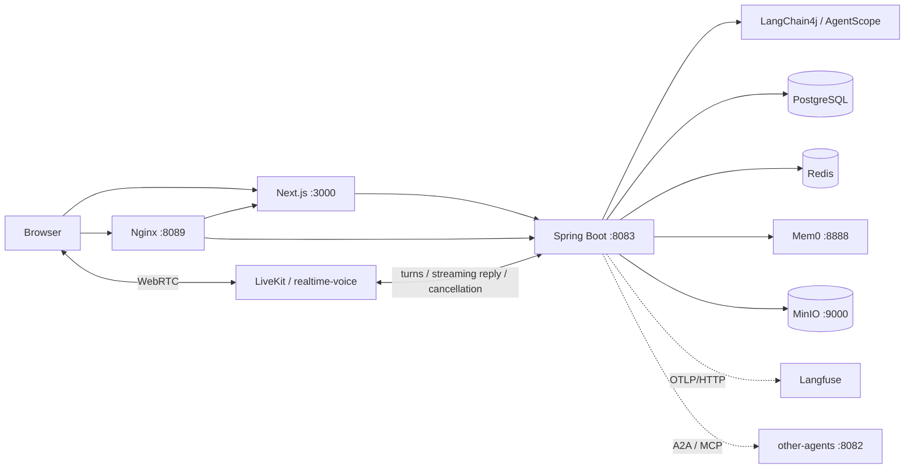
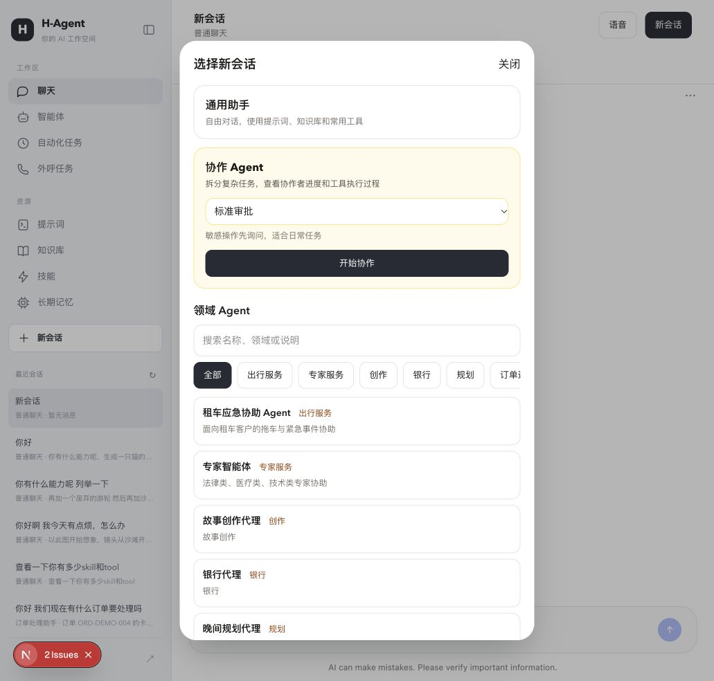
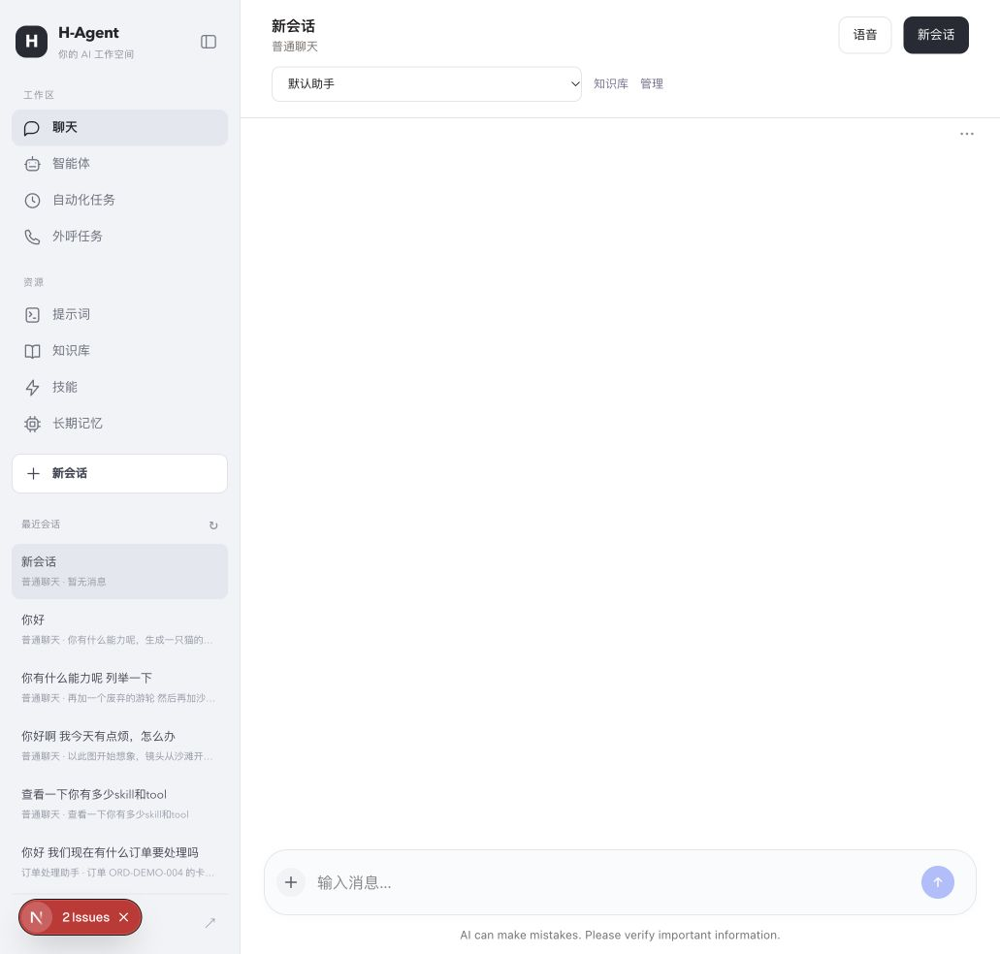
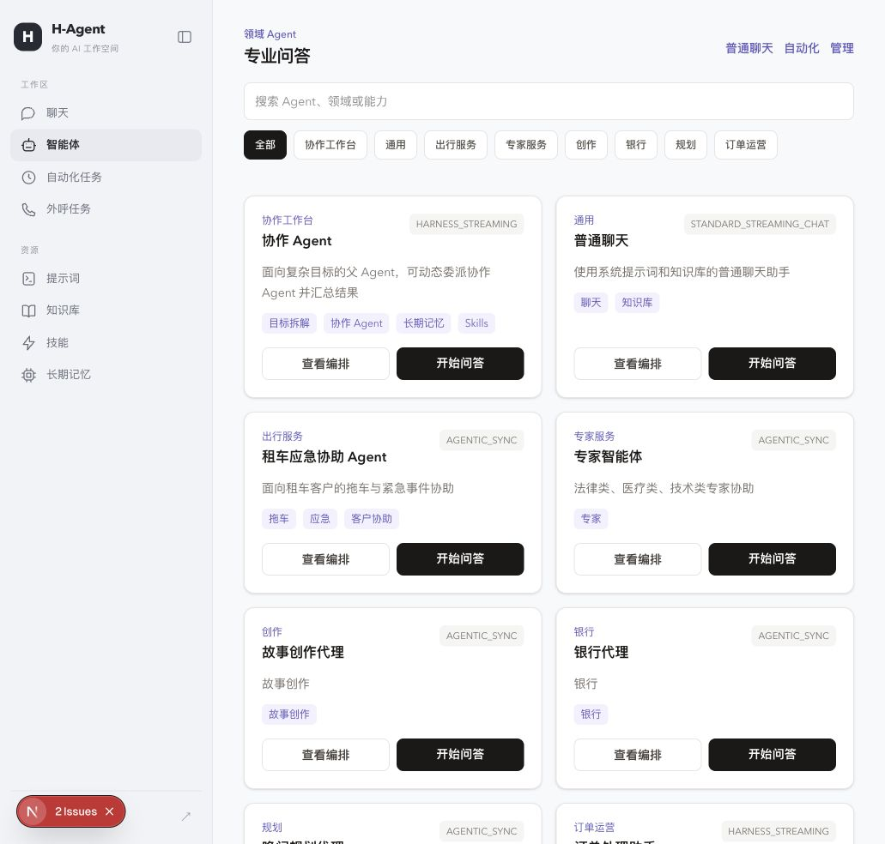
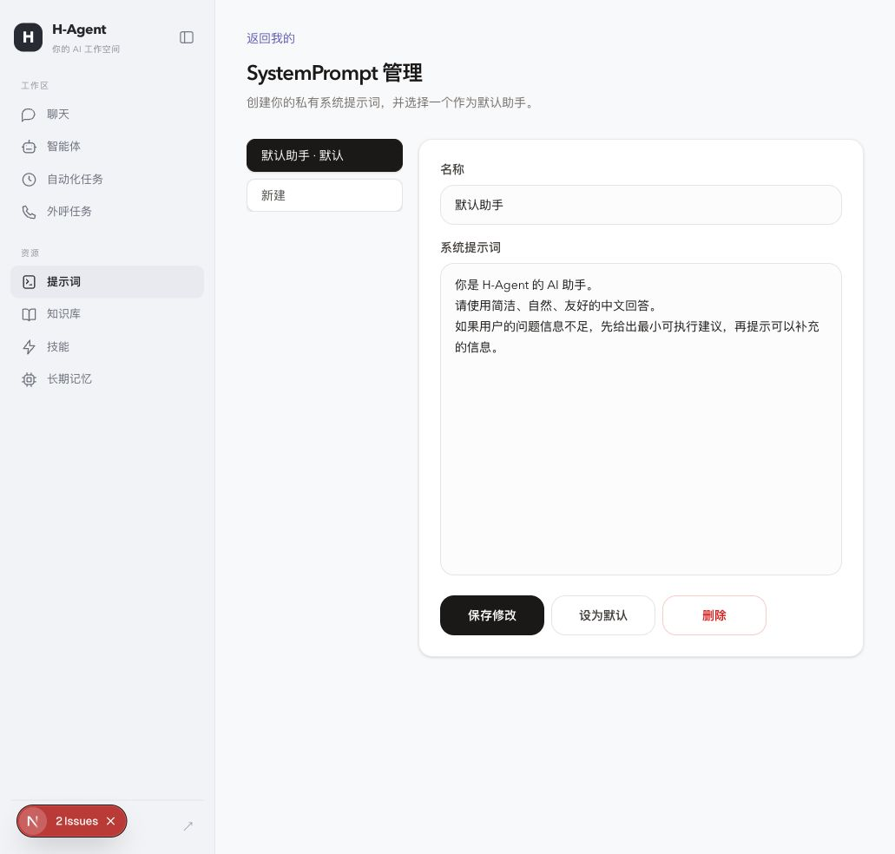
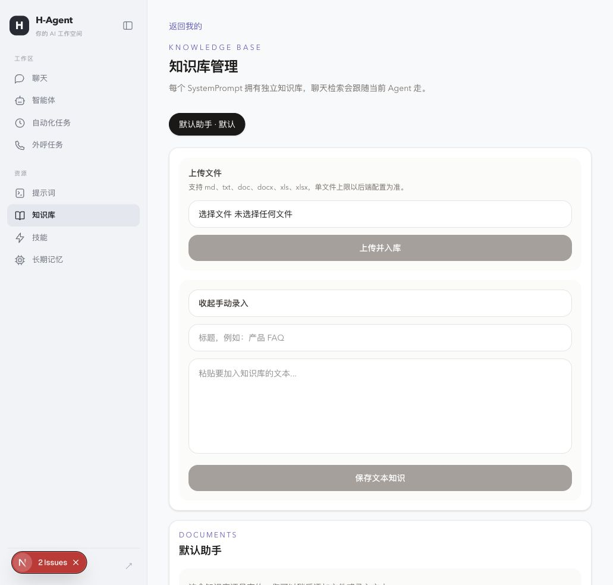
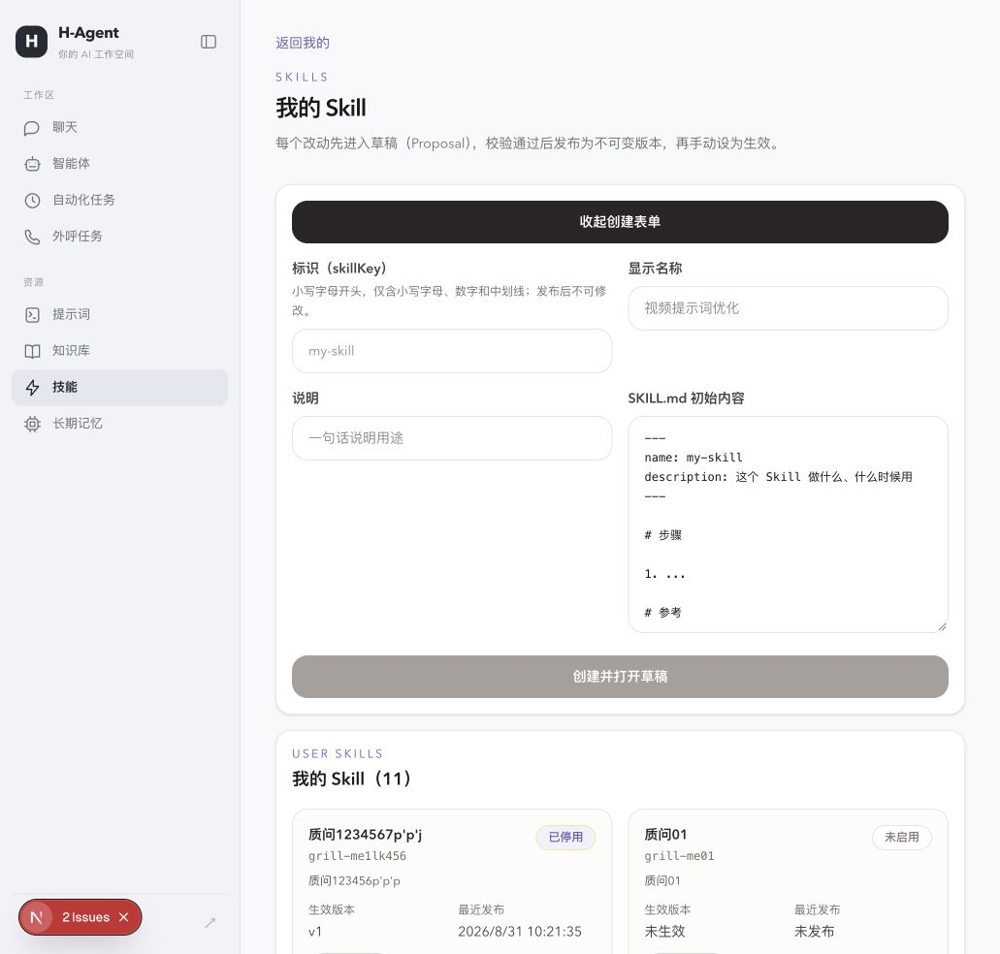
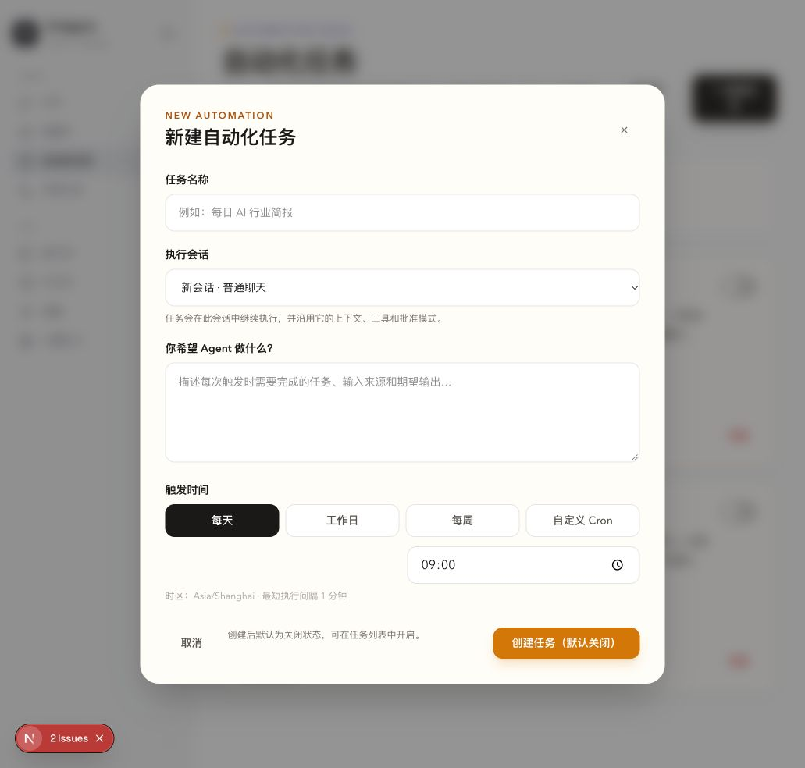
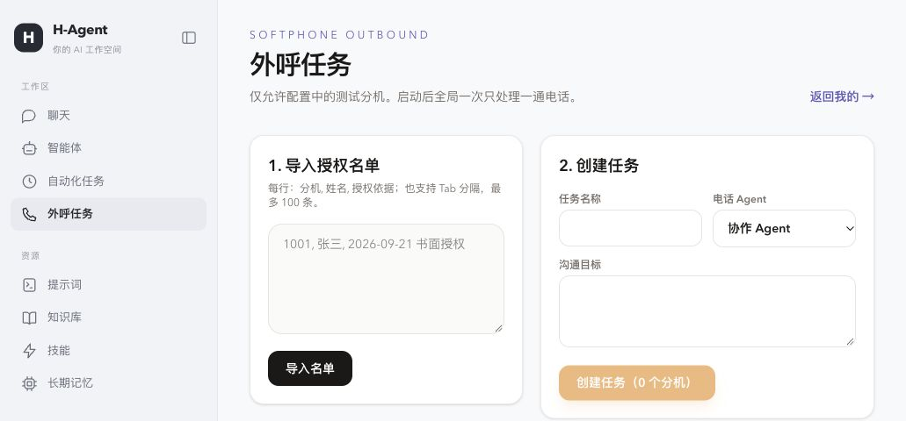

# H Agent

[简体中文](README_zh.md) | English

H Agent is a full-stack AI workspace for streaming chat, domain agents, Harness-style multi-agent collaboration, knowledge retrieval, long-term memory, versioned Skills, multimodal resources, and end-to-end agent observability.

The project combines a Next.js interface with a Spring Boot agent platform. It supports three execution styles—standard streaming chat, synchronous LangChain4j agent workflows, and an AgentScope Harness runtime—behind one session and chat experience.

> This repository is under active development. The configuration currently targets a development environment; review credentials, storage policies, and network exposure before production use.

## Highlights

- Streaming conversations with persistent sessions, Markdown rendering, and attachments.
- Standard assistants with private System Prompts and per-prompt RAG knowledge bases.
- Domain-agent catalog, topology views, and built-in specialist/workflow agents.
- Harness collaboration with dynamic subagents, progress events, human approval, workspace files, and Skills.
- Redis-backed short-term chat context plus Mem0-backed long-term memory for enabled LangChain4j agents.
- Versioned user Skills with proposal validation, immutable releases, activation, revocation, and MinIO artifacts.
- MinIO-backed private storage for chat files and generated image/audio/video artifacts.
- OpenTelemetry traces exported directly to Langfuse without making observability part of business correctness.
- Optional A2A/MCP agent service and a LiveKit realtime-voice path using Huoshan ASR/TTS with the existing Java Agent.

## Architecture



| Area | Main technologies |
| --- | --- |
| Frontend | Next.js 16, React 19, TypeScript, Tailwind CSS |
| Backend | Java 26, Spring Boot 4, LangChain4j, AgentScope, MyBatis-Plus, Flyway |
| Data | PostgreSQL/pgvector, Redis/Redisson, MinIO |
| Memory | Redis chat memory, Mem0 long-term memory, Harness `MEMORY.md` |
| Observability | OpenTelemetry, Langfuse, Micrometer, Prometheus |
| Optional services | A2A and MCP; LiveKit voice worker (Huoshan ASR/TTS, Java Agent control plane) |

## Workspace Tour

This tour was checked against the local pages on 2026-11-02. The interface uses a shared sidebar: **Workspace (`工作区`)** pages at the top, **Resources (`资源`)** below, and **Personal settings (`个人设置`)** at the bottom. Collapse the sidebar on desktop or use **Open navigation (`打开导航`)** on narrow screens.

| Group | Entry in the UI | Route | Purpose |
| --- | --- | --- | --- |
| Workspace | Chat (`聊天`) | `/chat` | Create sessions, resume conversations, inspect execution |
| Workspace | Agents (`智能体`) | `/agents` | Search capabilities, inspect topology, start Q&A |
| Workspace | Automations (`自动化任务`) | `/automations` | Schedule work in an existing session |
| Workspace | Outbound tasks (`外呼任务`) | `/outbound` | Manage authorized test extensions and call progress |
| Resources | Prompts (`提示词`) | `/me/system-prompts` | Edit private System Prompts and choose a default |
| Resources | Knowledge (`知识库`) | `/me/knowledge` | Maintain a separate knowledge base for each prompt |
| Resources | Skills (`技能`) | `/me/skills` | Create Skills and manage proposals and releases |
| Resources | Long-term memory (`长期记忆`) | `/me/memory` | Read and edit Harness `MEMORY.md` |
| Account | Personal settings (`个人设置`) | `/me` | View the account, access workspace settings, sign out |

### 1. Sign in and start a conversation

Open the [local chat workspace](http://localhost:3000/chat). If signed out, you are redirected to email login. The local demo account is `test@test` with password `12345678`; complete the slider verification when prompted. Use this account only for local development.

Select **New session (`新会话`)** in the sidebar or chat header. The welcome screen also offers **Start a new session (`开始新会话`)**.

| Entry | Runtime | How to start |
| --- | --- | --- |
| **General Assistant (`通用助手`)** | `STANDARD_STREAMING_CHAT` | Select the card to create a session with the default prompt. |
| **Collaborative Agent (`协作 Agent`)** | `HARNESS_STREAMING` | Choose an approval mode, then select **Start collaboration (`开始协作`)**. |
| **Domain Agent (`领域 Agent`)** | `AGENTIC_SYNC` or the registered runtime | Search by name, domain, or description; filter by domain and select a card. |



Each session is bound to its Agent and runtime. Use **Recent sessions (`最近会话`)** in the sidebar to resume a conversation, refresh the list, or load more history.

- General Assistant sessions show the System Prompt selector and **Knowledge (`知识库`)** / **Manage (`管理`)** links. Selecting another prompt creates a new session.
- Use **＋** to add attachments and the up-arrow **Send message (`发送消息`)** button to submit. During generation, use **Pause answer (`暂停回答`)**, then **Continue answer (`继续回答`)** to resume.
- Domain and collaborative sessions offer **Topology details (`拓扑详情`)**. When collaborators exist, progress cards appear in the header. Open a card to view its conversation in a right-hand panel; work continues after the panel is closed.
- Tool execution and approval requests appear in the message stream. On **Your approval is required (`需要你的批准`)**, review the tool summary and select **Allow execution (`允许执行`)** or **Deny (`拒绝`)**.



The General Assistant's **Voice (`语音`)** link opens a separate call page. Availability depends on LiveKit, the worker, and ASR/TTS configuration; see [realtime voice](realtime-voice/README.md).

### 2. Find an Agent and inspect its topology

Select **Agents (`智能体`)** to open **Professional Q&A (`专业问答`)**. Search by Agent, domain, or capability and filter by domain. Cards show the runtime, summary, and tags. Select **Start Q&A (`开始问答`)** for chat or **View orchestration (`查看编排`)** for topology. The top-right **Manage (`管理`)** link opens Agent management.



Car-rental assistance, experts, story creation, banking, and evening planning use predefined workflows. Collaboration and order processing use Harness. The current catalog determines which registered Agents are available.

### 3. Configure prompts and knowledge

Select **Prompts (`提示词`)** in the sidebar to select or create a System Prompt, edit its name and instructions, save it, and optionally make it the default assistant.



Select **Knowledge (`知识库`)**, choose a prompt, and upload a file or enter text manually. Supported formats include `md`, `txt`, `doc`, `docx`, `xls`, and `xlsx`. Each prompt owns an independent knowledge base; retrieval follows the prompt selected for the conversation.



### 4. Manage Skills and long-term memory

Select **Skills (`技能`)** to open **My Skills (`我的 Skill`)**. Create a Skill, then use its detail page to edit and validate a Proposal, publish an immutable release, and explicitly activate it. Release artifacts are stored in the configured MinIO Skill bucket.



Select **Long-term memory (`长期记忆`)**, choose an Agent, and read or edit its Harness `MEMORY.md`. Ordinary Harness uses these files as explicitly readable historical sources; editing a file does not directly change formal Mem0 memories. Other Agents retain their document-memory policies. Mem0 memories are managed through the API below.

### 5. Schedule automation tasks

Select **Automations (`自动化任务`) → ＋ New task (`新建任务`)**. Choose an existing session, enter a name and instruction, and set a daily, weekday, weekly, or custom Cron schedule. Tasks inherit the session's context, tools, and permissions; results are delivered to that session.

New tasks start paused. Check the schedule and time zone before enabling one. Task cards expose scheduler synchronization, run history, and manual execution. Chat-generated changes appear under **Pending proposals (`待确认提案`)** and only take effect after confirmation. Scheduled execution requires the XXL-JOB scheduler.



### 6. Manage test outbound calls

Select **Outbound tasks (`外呼任务`)**. The page follows **Import authorized contacts → Create task → Tasks and progress**. Supply a test extension, name, and consent basis per row; select contacts and a phone Agent, enter the communication goal, and create a task. Creation does not dial; **Start (`启动`)** queues execution.

Only configured test extensions are allowed, with one active call globally. Task details show call stages and provide stop and state-reconciliation controls. Actual calls require outbound infrastructure and phone Agent configuration.



<details>
<summary>Built-in Agent examples, approval modes, and runtime HITL details</summary>

#### General Assistant — `standard-chat`

- **Best for:** everyday Q&A, summarization, writing, knowledge-base Q&A, and tasks that need a custom persona or instruction set.
- **How it works:** streams the response token by token; combines the selected System Prompt, its private RAG knowledge base, Redis-backed conversation context, and enabled long-term memory.
- **Special UI:** only this mode shows the System Prompt selector and direct **Knowledge Base** / **Manage** links.
- **Example:** `Summarize our refund rules from the current knowledge base and list the supporting points.`

#### Collaborative Agent — `harness-agent`

- **Best for:** research-and-write work, multi-part analysis, planning, implementation tasks, or any goal whose independent parts can be delegated.
- **How it works:** acts as the parent Agent, decomposes the goal, creates collaborating Agents, follows their live progress, and consolidates their results. It can use workspace files, Skills, plans, model-directed memory tools, and human approval. Legacy `MEMORY.md` remains an explicitly searchable historical source.
- **What you see:** each collaborator appears with a running/completed/failed state. Its detailed transcript is kept separate from the parent answer, while the final result is returned in the main conversation.
- **Example:** `Compare three Java Agent frameworks. Delegate architecture, ecosystem, and observability research separately, then produce a recommendation table.`

Choose the approval mode when creating the collaborative session. The choice is inherited by the whole session tree and cannot drift during a run:

| Approval mode | Behavior |
| --- | --- |
| **Standard approval** | Ask before sensitive operations; recommended for ordinary work. |
| **Auto-accept edits** | File edits run automatically; other risky operations still ask. |
| **Read-only exploration** | Allow reading and analysis while blocking mutations. |
| **Do not ask** | Reject operations that would otherwise require approval. |
| **Bypass** | Use the most permissive mode in a trusted development environment; explicit deny/ask rules and non-bypassable safety checks may still apply. |

Choose the approval mode in the new-session picker shown above.

##### Runtime HITL approval flow

Approval mode selection is only the policy setup. The actual Human-in-the-Loop flow happens later, when the Harness permission engine evaluates a proposed tool call as `ASK`:

1. A tool call requiring confirmation pauses the run and displays **Your approval is required (`需要你的批准`)**, with the tool name and a safe summary.
2. Select **Allow execution (`允许执行`)** or **Deny (`拒绝`)**, or choose **Stop task (`停止任务`)**. After approval or denial, the Agent continues the same run using that decision.
3. Later operations may ask again. Pending requests can be recovered after a refresh or sign-in.

Approval cards apply to directly addressed Harness sessions, including the main conversation and a collaborator opened in the right-hand panel. A screenshot of a real runtime approval card remains pending; see [the screenshot checklist](docs/images/README.md).

#### Expert Agent — `export-assistant`

- **Best for:** questions clearly belonging to medical, legal, or technical domains.
- **Topology:** `CategoryRouter` first classifies the request, then a conditional Router invokes exactly one of **Medical Expert**, **Legal Expert**, or **Technical Expert**.
- **Memory:** the responsive expert leaves can recall USER, AGENT, and RUN Mem0 scopes when long-term memory is enabled.
- **Examples:** `Diagnose why a Java SSE connection closes after 60 seconds.` or `Explain the general legal risks in this contract clause.`
- **Boundary:** medical and legal output is informational assistance, not a substitute for a qualified professional or emergency service. Requests outside the three registered categories may not produce a specialist answer.

#### Car-rental Emergency Agent — `car-rental-assistant`

- **Best for:** rental-car breakdowns, towing, accidents, fire, medical emergencies, or police-related incidents.
- **Topology:** extracts customer/vehicle data → pauses for missing information through a Human-in-the-Loop node → evaluates towing → detects emergency types → conditionally invokes fire, medical, and/or police specialists → combines everything into one customer-facing response.
- **Required context:** customer name; booking reference or customer ID; vehicle make; vehicle model; and current location. If any item is missing, the Agent asks for it before continuing.
- **Example:** `I am Li Ming, booking B-1024, driving a Toyota Camry near Beijing South Station. The engine is smoking after a collision and my passenger is injured. What should I do?`
- **Boundary:** the workflow demonstrates assistance and simulated dispatch. In a real emergency, contact local emergency services first.

#### Story Creation Agent — `story-chat-agent`

- **Best for:** producing a short story for a specific topic, style, and audience.
- **Topology:** extracts topic/style/audience → asks for missing fields → creates a draft → adapts it for the audience → repeatedly edits and scores the style, stopping at a score of at least `0.8` or after five review iterations.
- **Memory:** the creative-writer leaf can recall enabled Mem0 context.
- **Example:** `Write a three-sentence cyberpunk story about a lost delivery robot, in a warm humorous style, for children aged 8–10.`

#### Bank Agent — `banker-agent`

- **Best for:** demonstrating Supervisor routing and tool calls for USD deposit/withdrawal requests.
- **Topology:** a bank Supervisor interprets the request, delegates to the deposit or withdrawal teller, invokes an in-process account tool, and summarizes the updated balance.
- **Example:** `Create a demo account for Alice with USD 100, then withdraw USD 25 and show the balance.`
- **Boundary:** this is an in-memory workflow demonstration, not a real banking system. It has no durable ledger, authentication, or financial controls, and process restarts can discard its demo account state.

#### Evening Planner Agent — `evening-planner-agent`

- **Best for:** quickly pairing dinner ideas with movies based on the user's mood.
- **Topology:** runs **Dinner Planner** and **Evening Activity Planner** concurrently, obtains three meals and three movies, and pairs them into the final plan.
- **Example:** `I feel tired and want a quiet, comforting evening. Recommend tonight's meal-and-movie combinations.`

#### Order Processing Assistant — `order-processing-assistant`

- **Best for:** order queries, ticket follow-up, fulfillment, and after-sales tasks.
- **Special UI:** runs on Harness. The **＋** menu offers **Select an order or ticket (`选择订单或工单`)** and **Images or files (`图片或文件`)**, so a business record can be attached as a reference.
- **Example:** `Review pending orders and list the next steps and decisions that need my confirmation.`

#### Optional A2A Story Agent — `a2a-story-assistant`

- **Availability:** appears only when the `other-agents` A2A integration is enabled and reachable.
- **How it differs:** the backend keeps the story-information gate and style scoring locally, while creative writing, audience editing, and style editing are executed by remote Agents through A2A. W3C trace context keeps the cross-service work in the same Langfuse trace.
- **Example:** use the same topic/style/audience prompt as the local Story Creation Agent, then compare the topology and trace across both services.

</details>

See [the screenshot checklist](docs/images/README.md) for capture maintenance.

## Prerequisites

- Java 26. Confirm that `mvn -version` also reports Java 26.
- Maven 3.9+.
- Node.js 22.15+ and npm.
- PostgreSQL with the `vector` extension available.
- Redis.
- MinIO with pre-created private resource and Skill buckets.
- A compatible self-hosted Mem0 service when long-term memory is enabled.
- A Langfuse project when trace export is enabled.
- Python 3.11–3.14 and `uv` only for `realtime-voice` development.

This repository does not currently provide a root Docker Compose stack for PostgreSQL, Redis, MinIO, Mem0, or Langfuse. Start those dependencies separately and point `.env` at them.

## Quick Start

### 1. Configure the environment

```bash
cp .env.example .env
```

At minimum, fill in the model, database, Redis, JWT, and MinIO values. The current backend configuration also enables Mem0 long-term memory, so fill all four Mem0 fields or set `MEMORY_LONG_TERM_ENABLED=false` for a development run without Mem0.

```dotenv
API_KEY=<model-api-key>
MODEL_NAME=<model-name>
ANTHROPIC_BASE_URL=https://api.minimaxi.com/anthropic

DB_URL=jdbc:postgresql://127.0.0.1:5432/h_agent_db?currentSchema=skill_platform,public
DB_USERNAME=h_agent
DB_PASSWORD=<database-password>

REDIS_HOST=127.0.0.1
REDIS_PORT=6379
REDIS_PASSWORD=<redis-password>
JWT_SECRET=<long-random-secret>

MINIO_ENDPOINT=http://127.0.0.1:9000
MINIO_ACCESS_KEY=<application-access-key>
MINIO_SECRET_KEY=<application-secret-key>
MINIO_RESOURCES_BUCKET=h-agent-resources
MINIO_SYSTEM_SKILLS_BUCKET=h-agent-skills
MINIO_USER_SKILLS_BUCKET=h-agent-skills
```

Never commit `.env` or real credentials.

### Nacos service registry

Both Java services register with Nacos by default. Set `NACOS_USERNAME` and `NACOS_PASSWORD` in the root `.env`; registration failure aborts startup. The SDK connects to `169.254.210.181:8848` with gRPC on `9848`, using namespace `bc2a5f7e-0ab7-452c-849c-13527706651f`. The console remains on `8081`, while backend now defaults to `8083`.

See [Nacos registration and discovery](docs/runbooks/nacos-service-discovery.md) for lifecycle, advertised addresses, configuration, and the shared discovery API. Existing A2A calls keep their configured addresses.

### 2. Build and run the backend

From the repository root:

```bash
mvn -pl backend -am package -DskipTests
java -jar backend/target/backend-0.0.1-SNAPSHOT.jar
```

Flyway applies database migrations on startup. The API listens on [http://localhost:8083](http://localhost:8083), and health is available at [http://localhost:8083/actuator/health](http://localhost:8083/actuator/health).

### 3. Run the frontend

In another terminal:

```bash
cd frontend
npm install
npm run dev
```

Open [http://localhost:3000/](http://localhost:3000/). Next.js rewrites `/api/*` to `http://localhost:8083` by default; override it with `BACKEND_API_BASE_URL` if needed.

### 4. Optional Nginx gateway

The development gateway configuration is [`deploy/nginx/h-agent-dev.conf`](deploy/nginx/h-agent-dev.conf). It exposes the combined application at `http://localhost:8089`, routes `/api/*` directly to Spring Boot, and sends all other traffic to Next.js.

```bash
nginx -t
nginx -s reload
```

## Mem0 Usage

Mem0 is the long-term-memory adapter for enabled LangChain4j agents. It is separate from:

- Redis short-term conversation windows; and
- the Harness `MEMORY.md` editor currently shown at `/me/memory`.

### Configure Mem0

```dotenv
MEM0_BASE_URL=http://127.0.0.1:8888
MEM0_API_KEY=<mem0-api-key>
MEM0_CONTRACT_VERSION=<pinned-deployment-version>
MEM0_OPENAPI_SHA256=<sha256-of-the-pinned-openapi-contract>
```

When `memory.long-term.enabled=true`, all four fields are required and missing values fail startup. Use the exact version and OpenAPI digest of the deployed service; floating Mem0 contracts are intentionally not accepted.

### Runtime behavior

- Ordinary `standard-chat` and `harness-agent` use shared memory tools. The current model decides when to search, save, revise, supersede, soft-delete, and restore; there is no automatic recall or turn-end/compaction memory extraction.
- New tools support USER, stable AGENT, and shared root SESSION scopes. Models may explicitly search historical sessions and read owned persisted product-message sources.
- Text is saved unchanged with `infer=false`. Revisions are retained locally; inactive memories are excluded from ordinary searches. PENDING writes can be inspected with `memory_operation` and reconciled without blindly repeating creates.
- Harness MEMORY.md and daily ledgers are legacy sources available only through explicit `source=LEGACY` search; they are not bulk-imported.
- Participating domain agents recall all three scopes and capture successful turns into RUN scope according to their registered memory policy.
- Existing domain-agent capture is written to a PostgreSQL outbox first, then delivered asynchronously to Mem0 with retries.
- Recall is fail-open: a Mem0 outage should not prevent an agent response.
- User identity and scope IDs are derived on the server; clients never submit raw Mem0 owner IDs.

| Scope | Meaning | Required API fields |
| --- | --- | --- |
| `USER` | Shared across agents and sessions for the authenticated user | `text`, `scope` |
| `AGENT` | Shared for one stable logical agent | plus `agentId` |
| `RUN` | Legacy stable agent + root session scope | plus `agentId`, `runId` |
| `SESSION` | Shared by a root session and its collaborating Agents | plus `runId` (root session ID) |

### Manage Mem0 memories through H Agent

Authenticate once and keep the local cookie:

```bash
curl -sS -c /tmp/h-agent-cookies.txt \
  -H 'Content-Type: application/json' \
  -d '{"email":"test@test","password":"12345678"}' \
  http://localhost:3000/api/auth/login
```

Create and list a user-scoped memory:

```bash
curl -sS -b /tmp/h-agent-cookies.txt \
  -H 'Content-Type: application/json' \
  -d '{"text":"Prefer concise answers in Chinese.","scope":"USER"}' \
  http://localhost:3000/api/memories

curl -sS -b /tmp/h-agent-cookies.txt \
  'http://localhost:3000/api/memories?scope=USER&pageSize=20'
```

Search, update, history, and delete are available at:

```text
GET    /api/memories/search?q=<query>&limit=10
GET    /api/memories/{localId}
PUT    /api/memories/{localId}              # text + expectedVersion
GET    /api/memories/{localId}/history
DELETE /api/memories/{localId}?expectedVersion=<version>
```

Updates and deletes use `expectedVersion` for optimistic concurrency and return HTTP 409 on a version conflict.

## MinIO Usage

MinIO is the only production resource-storage adapter in the current backend; there is no local-file fallback. It stores private chat uploads, generated media, and versioned Skill artifacts, while PostgreSQL stores ownership and metadata.

```dotenv
# S3 API endpoint—not the :9001 Console URL
MINIO_ENDPOINT=http://127.0.0.1:9000
MINIO_ACCESS_KEY=<application-access-key>
MINIO_SECRET_KEY=<application-secret-key>
MINIO_RESOURCES_BUCKET=h-agent-resources
MINIO_RESOURCES_PREFIX=h-agent/

# Optional dedicated Skill credentials/buckets
MINIO_SKILLS_ACCESS_KEY=<skill-access-key>
MINIO_SKILLS_SECRET_KEY=<skill-secret-key>
MINIO_SYSTEM_SKILLS_BUCKET=h-agent-skills
MINIO_USER_SKILLS_BUCKET=h-agent-skills
```

Create the buckets before the first operation. Use an application account limited to the required buckets rather than MinIO root credentials. Startup validates configuration syntax only; reachability, credentials, and bucket existence are exercised on the first storage operation.

To verify the integration:

1. Sign in and upload an attachment from the chat composer.
2. Send the message and confirm that the attachment can be previewed or downloaded.
3. Inspect the private resource bucket in the MinIO Console, normally on port `9001`.
4. Publish a Skill release and confirm an artifact appears in the Skill bucket.
5. Inspect storage metrics at `/actuator/prometheus` using the `h_agent_resource_storage_*` prefix.

> **Screenshot placeholder — MinIO resource and Skill buckets**
> `docs/images/demo-07-minio.png`

<!--  -->

Detailed storage behavior, IAM guidance, metrics, and recovery procedures are documented in [`docs/runbooks/minio-resource-storage.md`](docs/runbooks/minio-resource-storage.md).

## Langfuse Usage

H Agent creates OpenTelemetry traces for agent runs, model generations, tools, retrievers, workflows, A2A/MCP calls, and selected persistence operations. Traces are exported directly to:

```text
${LANGFUSE_BASE_URL}/api/public/otel/v1/traces
```

Configure project credentials from Langfuse:

```dotenv
LANGFUSE_BASE_URL=http://127.0.0.1:<langfuse-port>
LANGFUSE_PUBLIC_KEY=<project-public-key>
LANGFUSE_SECRET_KEY=<project-secret-key>
LANGFUSE_ENVIRONMENT=local
LANGFUSE_SAMPLE_RATE=1.0
LANGFUSE_CONTENT_MODE=structured
```

`LANGFUSE_BASE_URL` must be the Langfuse server, not the H Agent frontend. If Langfuse also uses port `3000`, move one service to a different host port. Leaving the URL and both keys empty disables export. A partial or invalid configuration degrades to no-op observability and does not block business requests.

To verify the integration:

1. Start the backend and check for `Agent observability ACTIVE` in its startup log.
2. Send a chat message or run a domain agent.
3. Open the Langfuse project and filter by environment `local`, service `backend`, session, or user.
4. Inspect the trace tree for agent, generation, tool, retriever, and workflow observations.
5. For cross-service traces, configure the same Langfuse variables for `other-agents` and enable A2A/MCP integration.

Business artifacts remain in MinIO; Langfuse receives bounded semantic references rather than duplicate file bytes. Resource health metrics remain in Prometheus and are not inferred from sampled traces.

> **Screenshot placeholder — Langfuse trace tree**
> `docs/images/demo-06-langfuse.png`

<!--  -->

## Optional Services

### Other agents (A2A and MCP)

```bash
mvn -pl other-agents -am package -DskipTests
java -jar other-agents/target/other-agents-0.0.1-SNAPSHOT.jar
```

The service listens on port `8082`. Enable the corresponding `agents.a2a.other-agents` or `agents.mcp.other-agents` settings in the backend only when needed.

### Realtime voice

`realtime-voice` is a LiveKit media worker. It performs VAD, Huoshan ASR and Huoshan streaming TTS; the Java backend invokes the existing Agent, persists confirmed subtitles in the current session, and owns cancellation. It is disabled until the LAN LiveKit URL and service credentials are configured. See [`realtime-voice/README.md`](realtime-voice/README.md) and [`docs/runbooks/voice-lan-deployment.md`](docs/runbooks/voice-lan-deployment.md).

## Project Layout

```text
h-agent/
├── frontend/             Next.js web application
├── service-registry/     Shared Nacos registration and discovery
├── backend/              Main Spring Boot API and agent runtime
├── agent-observability/  Shared OpenTelemetry/Langfuse module
├── other-agents/         Optional A2A and MCP service
├── realtime-voice/       LiveKit media worker for station voice calls
├── deploy/               Nginx and Prometheus configuration
├── docs/                 Designs, ADRs, plans, runbooks, and screenshots
├── teaching/             Teaching notes and reference material
├── .env.example          Environment-variable template
└── pom.xml               Maven reactor root
```

## Validation

```bash
# Java modules
mvn -pl backend -am test
mvn -pl other-agents -am test

# Frontend
cd frontend
npm test
npm run lint
npm run build

# Realtime voice worker
cd realtime-voice
uv run pytest
uv run ruff check .
uv run ruff format --check .
```

## Troubleshooting

| Symptom | Check |
| --- | --- |
| Backend fails before listening | Confirm `mvn -version` uses Java 26 and all required MinIO/Mem0 fields are present. |
| Frontend shows API/network errors | Confirm the backend is on `8083` and `BACKEND_API_BASE_URL` is correct. |
| Upload fails | Use MinIO API port `9000`, verify the bucket exists, and check the application account policy. |
| No long-term recall | Verify Mem0 configuration, enabled agent policy, and pending/dead-letter outbox rows. |
| No Langfuse traces | Check all three Langfuse fields, startup status, sampling, and that the base URL is not the H Agent UI. |
| Knowledge ingestion fails | Confirm PostgreSQL/pgvector availability and the supported file type/size. |

## Documentation

- [Chinese README](README_zh.md)
- [MinIO resource-storage runbook](docs/runbooks/minio-resource-storage.md)
- [LLM-directed memory tools design](docs/superpowers/specs/2026-11-07-llm-directed-memory-tools.md)
- [Existing domain-agent Mem0 design](docs/superpowers/specs/2026-08-27-langchain4j-mem0-long-term-memory-design.md)
- [Unified Langfuse trace design](docs/superpowers/specs/2026-08-26-unified-agent-langfuse-trace-design.md)
- [Realtime voice guide](realtime-voice/README.md)
- [Domain language](CONTEXT.md)

## Contributing

Keep secrets out of commits, preserve module boundaries, add tests for behavioral changes, and run the relevant validation commands before opening a pull request.

## License

Licensed under the [MIT License](LICENSE).
