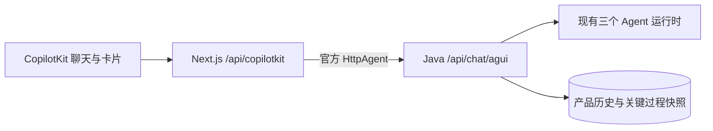

# AG-UI 对话接入

## 使用的 SDK

- `@copilotkit/react-core` / `@copilotkit/runtime` 1.79.1，使用 `/v2` 入口。
- `@ag-ui/client` / `@ag-ui/core` 1.0.2，与 CopilotKit 的依赖版本一致；RxJS 7.8.1。
- `io.agentscope:agentscope-extensions-agui:2.0.2`。复用 `RunAgentInput`、`AguiEvent`、`AguiEventEncoder`、`AgentEventConverterRegistry` 与 `AguiStreamContext`。

参考：[CopilotKit Runtime](https://docs.copilotkit.ai/deepagents/backend/copilot-runtime)、[AG-UI HttpAgent](https://docs.ag-ui.com/sdk/js/client/http-agent)。不需要配置 CopilotKit 云账户。

## 链路与状态归属

Java 拥有任务执行、会话授权和业务 Agent Run；Next.js 的 `JavaAgentRunner` 仅使用 SDK 转发执行、观察、运行状态和停止请求，按每个 HTTP 请求创建并转发其 Cookie/Authorization，不缓存用户身份。客户端提交的工具、state 和旧历史不覆盖服务端模型上下文。

AG-UI `threadId` 是实际 Agent Session（包括子会话）；`runId` 是一次前端交互身份。重复提交相同 runId 和请求只观察原任务，不再追加用户消息；改变同一 runId 的请求会被拒绝。审批恢复创建新的协议交互，同时继续原来的业务 Agent Run。

普通 LangChain4j 聊天和同步 Agent 工作流以原生回调映射标准文本、步骤及工具事件；同步工作流只流送真实步骤与最终结果。Harness 原始 AgentEvent 仅通过内部接缝交给官方转换器，父回复不会重复拼接旧 chunk，也不会拼入子 Agent 的文本。旧后端 SSE 接口仍可兼容已有消费者，网页端已经移除自写 SSE 解析。

SDK 的 Jackson 2 MessageContent 解码器与 Boot 4 默认 Jackson 3 不兼容，因此入口由 SDK `JsonCodec` 读取请求；SSE 数据由 SDK encoder 生成 JSON，再由 Spring 的 `ServerSentEvent` 包装一次。

`AguiEventJson` 只移除 AgentScope 2.0.2 在非运行生命周期事件上附加的旧 `threadId/runId` 字段，避免 AG-UI 1.x 严格校验逐条输出字段丢弃警告。协议事件及其 JSON 仍由官方 SDK 生成。

## 持久化和执行控制

Flyway `V20261023_01__agui_run_snapshots.sql` 新增 `chat_interaction_runs`，保存关键步骤、工具结果摘要、业务卡片及最新未完成文本快照，不保存逐 token 或原始事件日志。业务消息和资源仍由现有表保存。历史资源读取时重新生成链接；自动化提案和批准请求以对应业务记录为准。

浏览器取消 HTTP 订阅只移除观察者。显式停止通过独立服务端入口发出取消，按数据库中的会话树停止该分支，包括未完成后代；已完成操作不回滚。LangChain4j 使用 streaming handle/协作式检查，同步阻塞工具仍受工具本身的中断能力限制。

执行中的根任务每秒更新快照，委派子任务每两秒更新快照。跨连接或服务实例观察时读取同一份持久化快照；停止请求也保存在数据库中交给执行实例处理。超过 60 秒没有心跳的任务会被标记为中断，保留已保存的过程，不自动重复执行工具。

## 界面与扩展卡片

`components/agui-chat-thread.tsx` 为每个父/子会话注册独立 SDK 代理，使用 CopilotKit Chat、消息状态与工具渲染。`components/agui-cards.tsx` 注册 activity 类型、Zod schema 和 React renderer。

| Activity 类型 | 用途 |
| --- | --- |
| `h-agent.progress` | 运行状态、可展开步骤和工具结果摘要 |
| `h-agent.automation` | 自动化提案及确认/放弃，复用原业务接口 |
| `h-agent.approval` | 可恢复批准卡片，使用原授权和续跑逻辑 |
| `h-agent.resource` | 文件、图片、音频、视频交付 |
| `h-agent.subagent` | 协作者状态 |
| `h-agent.reasoning` / `h-agent.assignment` | 旧思考消息、父 Agent 的原始委托 |

增加新卡片时，在执行编排提交业务结果后调用 `AguiRunProjection.activity(stableId, type, content)`；在前端 registry 增加对应 schema 和 renderer。稳定 ID 让同一卡片更新原位替换；content 只放产品展示数据和业务身份，按钮继续调用有授权/幂等控制的业务接口。无需新增 SSE parser 或直接修改聊天页面。

## 部署与验证

前后端一起更新；Java 启动时执行新 Flyway 迁移。Next.js 原 Java API rewrite 已移至 fallback，避免覆盖 CopilotKit 动态路由。经过 Nginx 时，`/api/copilotkit` 必须转发 Next.js 并关闭流缓冲；仓库的开发 Nginx 配置已更新。

构建：`JAVA_HOME=<JDK26> mvn -pl backend -am -DskipTests compile`；前端 `npm run build`、`npm run lint`、`npm test`。

后端新增协议转换、接口编解码、断线继续、幂等、授权、停止分支和 streaming handle 取消测试。可通过 `AGUI_TEST_DB_URL/USERNAME/PASSWORD` 运行 `AguiRunSnapshotPersistenceTest`；该测试仅使用连接内的临时表并回滚，不迁移应用数据库。

浏览器预览验证使用隔离的模拟 AG-UI 事件，覆盖发送、过程展开、提案确认、刷新恢复、父子会话挂载；截图见 `verification/agui-chat-preview.png`。真实模型、外部工具和审批权限引擎的完整联调仍应在对应服务已配置的环境中执行。
