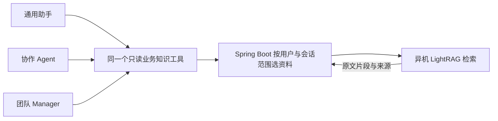

# h-agent 接入 LightRAG 的 0→1 行动指南

第一版覆盖现有的**通用助手（普通聊天）、协作 Agent（Harness）和团队 Agent 的 Manager**。先用通用助手打通一题，再让协作 Agent 和 Manager 复用同一个只读检索能力。三个入口都能查租车事故结案或交接所需的材料、适用流程和历史处理依据，并说明每个关键结论来自哪里。用同一批题比较纯向量和图谱检索，再根据实测错误决定哪些业务概念值得建模。

试点选**结案与交接**，用合成或脱敏资料。LightRAG 按[异机部署教程](../../deploy/lightrag-deploy/README.md)运行，复用现有 PostgreSQL 和 pgvector，并使用专用库。查看索引和检索细节用 LightRAG 的 WebUI。

## 行动顺序

| 阶段 | 要做的事 | 完成标志 |
| --- | --- | --- |
| 0. 跑通 | 在目标设备启动 LightRAG，上传下面四份样例。 | 每份文档完成索引，可以查到原文和来源。 |
| 1. 做对照 | 给样例题先标答案和证据，再用相同语料对比 `naive` 与 `mix`。 | 能拿一道题解释证据是在哪一步找对、漏掉或用错的。 |
| 2. 接入 Agent | 在 Spring Boot 增加调用 LightRAG 的适配器和只读工具，先接通用助手，再接协作 Agent 和团队 Manager。 | 三个入口都能完成带来源的问答。协作者和团队房间的资料访问符合各自权限，空结果与服务超时有各自的表现。 |
| 3. 用业务资料复测 | 找实际负责交接的人选案例并核对答案，试用后记录问题和处理时间。 | 能判断图谱在哪些问题上有收益，并确认资料改版后可正确查询。 |
| 4. 补最小本体 | 选一个反复出错的实体或关系，明确含义、证据来源和生效时间。 | 同一批题复跑后，能解释改动改善了什么，仍有哪些问题要靠业务系统或人工确认。 |

## 0. 在目标设备跑通四份练习材料

按部署教程验证 `/health`，再登录 WebUI。把以下四段各保存为一个 UTF-8 文本文件，用对应文件名上传到试点工作区。内容均为虚构数据。

```text
文件名：rescue-sop-v1.txt
LR-SOP-01 v1。适用于 2026-01-01 至 2026-06-30 发生的租车事故（含首尾两天）。
跨门店事故由原租门店接手结案交接。结案材料包括事故登记和维修记录。
```

```text
文件名：rescue-sop-v2.txt
LR-SOP-01 v2。自 2026-07-01 起生效，以事故发生日选择适用版本。
跨门店事故由区域救援组接手结案交接。结案需核对事故登记、维修记录及接手团队的交接确认。
```

```text
文件名：incident-ar-101.txt
事故单 AR-101，发生日期 2026-07-12。租赁订单 LR-100 使用车辆 V-023，
原租门店为北城门店，归还门店为南站门店。区域救援组接手，值班经理张宁曾协助协调。
复盘记录。原租和归还门店不同，符合跨门店条件。事故登记和维修记录已收齐，尚缺接手团队的交接确认。
```

```text
文件名：repair-r-091.txt
维修工单 R-091，车辆 V-023（现场称 023 号车）。维修摘要为更换前轮轮胎。
```

上传后等四份材料进入 `Processed`。如果采用 API，提交用 `/documents/upload` 或 `/documents/text`，再凭返回的 `track_id` 查询 `/documents/track_status/{track_id}`。提交成功代表入队，`Processed` 才代表该文档完成本轮处理。 [LightRAG 入库与状态查询](https://github.com/HKUDS/LightRAG/blob/v1.5.8/docs/LightRAG-API-Server.md#asynchronous-document-indexing-with-progress-tracking)

## 1. 建立向量和图谱检索对照

先记录人工答案和证据，再看检索结果。先用原始问题比较 `naive`（文本向量检索）和 `mix`（图谱与文本向量检索），尽量保持语料、索引和文本片段预算一致。要比较最终回答时，再用相同的回答模型、提示词和证据预算。 [LightRAG 检索模式与结构化接口](https://github.com/HKUDS/LightRAG/blob/v1.5.8/lightrag/api/routers/query_routes.py#L1430)

| 类型 | 提问 | 人工标准答案和关键来源 |
| --- | --- | --- |
| 单文档 | 按 v2，跨门店事故结案要核对哪些材料？ | 事故登记、维修记录、交接确认。`rescue-sop-v2.txt`。 |
| 跨文档 | LR-100 用了哪辆车？对应维修工单和维修内容是什么？ | V-023，R-091，更换前轮轮胎。需要 `incident-ar-101.txt` 和 `repair-r-091.txt`。 |
| 规则加案例 | AR-101 为什么转给区域救援组？结案还缺什么？ | 事故发生在 v2 生效后，且原租和归还门店不同。还缺交接确认。需要 `rescue-sop-v2.txt` 和 `incident-ar-101.txt`。 |
| 历史有效期 | 2026-06-20 发生的跨门店事故，当时该由谁接手结案？ | 原租门店。`rescue-sop-v1.txt`，按事故发生日判断。 |
| 证据不足 | 张宁现在有权审批 R-091 的维修费用吗？ | 资料只能确认他曾协助协调。要回答当前审批权，需要查询有效授权记录。 |

可以在 WebUI 直接切换模式，也可以从目标设备执行下列命令。通过部署教程的 SSH 转发访问时，把 URL 中的端口改为 `19621`。下面的脚本用 Bash 运行，两份结果会保存到当前目录。

```bash
LIGHTRAG_URL='http://127.0.0.1:9621'
printf 'LightRAG API Key: '
read -rs LIGHTRAG_TEST_KEY
printf '\n'

for mode in naive mix; do
  curl -fsS --max-time 60 "${LIGHTRAG_URL}/query/data" \
    -H "X-API-Key: ${LIGHTRAG_TEST_KEY}" \
    -H 'Content-Type: application/json' \
    --data "{\"query\":\"LR-100 对应的车辆、维修工单和维修内容是什么？\",\"mode\":\"${mode}\",\"chunk_top_k\":8,\"enable_rerank\":false}" \
    -o "lightrag-${mode}.json" \
    -w "${mode} 检索耗时 %{time_total}s\n"
done

unset LIGHTRAG_TEST_KEY
```

先看 `data.chunks` 和 `data.references`，再看 `mix` 的 `data.entities` 和 `data.relationships`。原文有证据但分块没带全，就调整分块。片段完整但没进入结果，就检查查询、召回和重排。原文找齐了却答错，就看提示词、日期和引用。两种模式在四份小样例上都答对很正常，保留结果作为联通验证，实际收益用后续语料判断。 [RAG 原始论文](https://arxiv.org/abs/2005.11401) · [LightRAG 论文](https://arxiv.org/abs/2410.05779)

记录模板直接复制到你的评测笔记，每题每种模式一行。

| 题号 | 模式 | 预期证据 | 实际命中 | 答案与引用是否正确 | 用时 | 问题原因与下次改动 |
| --- | --- | --- | --- | --- | --- | --- |
| 02 | `mix` | 事故单 + 维修工单 | 待填 | 待填 | 待填 | 待填 |

## 2. 接进通用助手、协作 Agent 和团队 Manager



### 后端实施清单

1. **加一个 HTTP 适配器。** 通过部署配置提供启用开关、服务地址和 API Key。通用助手跨设备调用时，配置后端可访问的私网入口，例如在目标设备经已有私网网关转发到 `127.0.0.1:9621`。在适配器内调用 `POST /query/data`，设置超时，解析结构化结果，把可用片段和出处交给 h-agent 生成回答。 [异机部署及回环端口说明](../../deploy/lightrag-deploy/README.md) · [查询端点实现](https://github.com/HKUDS/LightRAG/blob/v1.5.8/lightrag/api/routers/query_routes.py#L1430)
2. **定义一个只读工具。** 建议工具名 `search_rescue_knowledge`，第一版只收 `query`。三种 Agent 共用查询逻辑、来源映射和结果格式，通过 LangChain4j `ToolProvider` 和 AgentScope `Toolkit` 注册。从可信调用上下文取用户身份和会话范围，再选择可访问的资料集。同一工作区只放该使用范围共有的资料。工具描述写明「需要查询救援流程、交接依据或历史复盘时使用」。个人知识仍用现有 `knowledge_search`。 [LangChain4j 知识工具](../../backend/src/main/java/com/h/backend/knowledge/interfaces/tool/KnowledgeToolProvider.java#L18) · [AgentScope 知识工具](../../backend/src/main/java/com/h/backend/knowledge/interfaces/tool/AgentScopeKnowledgeTools.java#L17)
3. **把来源落实到业务资料。** 上传时用可以区分文档与版本的文件名，后端保存它和业务文档 ID、版本、资源引用的对应关系。查询结果的 `reference_id` 只用于关联本次响应中的片段与来源。核对来源授权和规则适用时间后，把有限的原文片段和出处交给模型。实体与关系摘要留给排查。聊天先显示来源标题及版本，补可点击链接时通过 h-agent 的鉴权入口打开原文。已有个人知识库的历史上传原件未持久化，试点选用可追溯的原件，业务文件继续走现有 MinIO 资源管理。 [现有文档接口说明](../../backend/src/main/java/com/h/backend/knowledge/interfaces/web/KnowledgeDocumentController.java#L68) · [现有文件存储约定](../adr/0003-business-artifacts-remain-in-minio.md)
4. **区分空结果和服务故障。** v1.5.8 无命中可能返回 HTTP 200 和 `metadata.failure_reason=no_results`，此时告诉用户缺哪份证据。超时、鉴权失败和响应格式错误归为查询暂时不可用。通过开关关闭业务工具可退出试点，通用助手仍通过原有工具响应个人知识查询。排查时记下查询耗时、结果状态和调用链，沿用 h-agent 的工具观测。 [上游无命中响应](https://github.com/HKUDS/LightRAG/blob/v1.5.8/lightrag/lightrag.py#L6443-L6457) · [h-agent 的 Trace 说明](../../README_zh.md#langfuse-使用说明)

### 三个入口的注册和使用

| 入口 | 怎么接入 | 怎么使用 |
| --- | --- | --- |
| 通用助手（普通聊天） | 在 HAssistant 的 `ToolProvider` 注册，复用现有工具观测。 | 用户提问后直接检索并回答，附文档标题、版本和出处。 |
| 协作 Agent（Harness） | 在父 Agent 的 `Toolkit` 注册为只读。委派给协作者时，其定义声明、平台工具权限和父级限制仍共同决定它能否直接查询。 | 父 Agent 可自己找依据，也可让有权限的协作者查证。汇总时保留原始文档引用。 |
| 团队 Agent 的 Manager | 在启用 `MATRIX_TEAM_ENABLED` 的环境中，通过 `TeamManagerConfig` 的 `Toolkit` 注册，由 Manager 直接调用。人类请求按 Matrix 发送者映射到工作台用户，委派回报按已验证的 Worker、任务和房间关联确认归属。 | Manager 可以先查材料再分配任务，也可以核对 Worker 回报后补查。发到房间或转交 Worker 的片段与引用按接收方可见范围返回。 |

团队房间里的答复和进度会被房间成员看到。Manager 查询前确认发起人是房间成员、可访问该资料集，且资料集允许在该房间共享。房间进度只显示查询状态，最终答复提供校验过的引用。团队侧的工具直接注册给 Manager。 [HAssistant 注册](../../backend/src/main/java/com/h/backend/chat/infrastructure/config/ChatModelConfig.java#L153) · [协作 Agent 注册](../../backend/src/main/java/com/h/backend/chat/infrastructure/config/HarnessAgentConfig.java#L384) · [协作者能力策略](../../backend/src/main/java/com/h/backend/chat/domain/subagentdefinition/SubagentCapabilityPolicy.java#L72) · [Manager 注册](../../backend/src/main/java/com/h/backend/team/TeamManagerConfig.java#L113) · [消息归属](../../agent-capabilities/src/main/java/com/h/capabilities/seam/matrix/TeamHumanDirectory.java#L85) · [房间访问检查](../../agent-capabilities/src/main/java/com/h/capabilities/seam/matrix/TeamRoomAuthorizer.java#L43) · [房间进度发布](../../matrix-team/src/main/java/com/h/matrixteam/TeamProgressReporter.java#L97)

### 联调清单

- [ ] 试点用户在普通聊天里发送「查救援业务资料。AR-101 为什么转交区域救援组，结案还缺什么？列出判断依据和来源」。确认工具调用、答案和两份来源相符。
- [ ] 在协作 Agent 里用同一道题验证父 Agent 直接查询。再委派一次查证任务，分别确认有权限的协作者可以检索并回传出处，受父级限制的协作者无法查询。
- [ ] 在授权的团队房间里请 Manager 用同一道题核对一条 Worker 回报。确认实际调用者是 Manager，进度仅显示状态，最终答复保留原始出处。换到未授权的房间或用无法校验任务归属的回报重试，确认在请求 LightRAG 前被拒绝。
- [ ] 用同一用户问一次普通聊天问题及一次个人知识查询，确认分别走相应入口。用非试点用户提出同一业务问题，确认工具和原文都不可访问。
- [ ] 模拟 LightRAG 超时和正常返回空结果，确认助手给出不同提示。询问张宁当前审批权时，确认助手明确缺少有效授权记录。
- [ ] 普通聊天先显示可核对的来源。需要日常批量比较，或业务人员反复要求并排查看证据时，再考虑增加检索对比页。

## 3. 进入真实业务试用

找负责交接的同事选一组近期案例，替换为脱敏复盘、已发布的现行和旧版 SOP、交接单或维修摘要。建议先做约 20 道有标准证据的问题，留几道未参与调试的题做最后一轮检查。升级时重新用同一语料和题集跑一遍，记录分块策略、Embedding 模型、检索模式和来源版本，方便复现差异。

- **检索表现**关注关键证据找回了几条。对跨文档题，要能指出 `mix` 实际补到了哪份材料。用相同资料跑 h-agent 现有向量检索，可再做一次产品侧对照。
- **回答表现**关注出处能否支持结论、适用版本是否正确、证据不足时是否说明缺口。分别记录检索与完整回答的耗时，有数据时也记录入库和查询的模型用量。
- **业务表现**请处理交接的人拿几件结案做盲查，记录从接到问题到找齐依据所用的时间、遗漏的关键材料及还需向谁确认。图谱能补证据的场景使用 `mix`，基础查询按实测选择检索方式。授权和规则版本的错误先修复，再扩大试用。

试用阶段用手动入库即可。当同一类材料开始频繁改版或撤回，再做后台同步。保留文档 ID、版本和 LightRAG 文档标识，按 `track_id` 跟踪状态，新版本完成后发布，再让旧版本退出默认查询。保留获授权的历史查询路径，用事故发生日选择适用版本。资料撤回时，从相应工作区的派生索引中移除并复查检索结果。对仍在变化的订单状态、团队归属和批准权限，由应用查对应业务系统。

## 4. 从一次实际错误入手学图谱和本体

### 练习一：同一辆车被拆成两个实体

在练习资料的副本里，把维修工单中的 `V-023` 换成只有「023 号车」，再重跑 LR-100 的跨文档题。观察结果里是否出现两个未经关联的名称。补一条可核实的车辆别名映射，或在入库时用业务 ID 统一名称，再跑同一道题。这一步让你看到实体对齐如何影响召回。保留同名但属于不同车辆的反例，检查合并规则是否过宽。 [LightRAG 实体类型配置](https://github.com/HKUDS/LightRAG/blob/v1.5.8/docs/ProgramingWithCore.md)

### 练习二：协调过的人被当成审批人

把三个容易混淆的关系写进一张小表，加上来源和时间规则，再给回答做回归验证。这张表就是第一版业务模型，后续可以把需要自动执行的规则放进应用的校验逻辑。

| 关系 | 含义 | 权威来源及时间 |
| --- | --- | --- |
| 曾协助协调 | 某人曾参与一宗具体事故的协调。 | 已确认的事故复盘，记录事件日期。 |
| 当前负责 | 某个岗位或团队负责一类业务或特定案件。 | 有效职责或交接记录，记录生效和失效时间。 |
| 有审批权 | 某主体按适用授权批准某类事项，可能受金额或范围限制。 | 审批配置或授权记录，按查询时点核对范围和有效期。 |

做完后用两个时点验证重组前后各由谁负责。旧复盘仍能解释当时为何作出决定，现行授权由当前记录回答。如果还要深入形式化本体，用同一例子练一次 OWL 中的类、实例和对象属性，再用 SHACL 表达一条具体的数据校验规则。 [Stanford 本体开发入门](https://protege.stanford.edu/publications/ontology_development/ontology101-noy-mcguinness.html) · [W3C OWL Primer](https://www.w3.org/TR/owl2-primer/) · [SHACL](https://www.w3.org/TR/shacl/)

### 让经理经验随业务更新

在结案复盘里记录触发条件、判断依据、例外、确认人，以及适用范围或复核时间。比如「跨门店且交接确认缺失时，先联系区域救援组补确认，因为它保存接手记录。旧流程时期的案件按当时版本处理。」复盘可以提供历史先例，正式规则走现有发布渠道。下一次职责或流程调整时，由负责发布和交接的人更新来源，重新验证涉及当前职责、历史职责和证据不足的三类题。

**第一轮完成后，你应该能在三个入口复现同一道跨文档题。** 保留四份样例和五道题的对照结果，下一轮优先修你亲手复现的一个问题。
