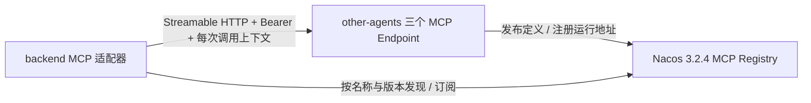

# 现有 MCP 与 Nacos 3.2.4 的接入评估

调研日期：2026-11-13。范围：当前提交中的 Java MCP 服务、客户端和共享注册模块；官方文档、已下载的精确版本源码。本文是可行性评估与实施建议，不代表接入已经完成。

## 结论

可以搭配使用，推荐把 **MCP 定义、版本和运行地址的注册发现交给 Nacos，保留现有 MCP 服务与直连调用链**。实现可复用项目已使用的 Nacos Java SDK 3.2.4，不必为此替换 LangChain4j、AgentScope 或引入 Spring Cloud。

Nacos Registry 保存和发现能力描述与运行入口；工具的 Java 实现、订单事务、用户身份校验和 MCP 协议会话仍由应用负责。不能把当前 Java 工具代码上传到 Nacos 后就关闭 `other-agents`。现有 HTTP/RPC API 转 MCP 是另一条路线，需要协议转换组件，也不等于迁移业务执行。[官方 AI Registry 概览](https://nacos-group.github.io/en/docs/v3.2/manual/user/ai/ai-registry-overview/)

第一阶段建议直接接入原生 AI Registry；Router、网关及控制台动态工具治理放在后续按需要引入。

精确 SDK 与 Router 源码证据另见[一手资料核查笔记](2026-11-13-nacos-mcp-official-notes.md)。官网 latest 已是 3.3，本文不将其新增的发布生命周期当作现有 3.2.4 的能力。

## 现状与迁移对象

| 部分 | 当前实现 | 接入 Nacos 后 |
| --- | --- | --- |
| MCP 服务端 | `other-agents` 内手工装配多个 Streamable HTTP Server | 保留，增加定义发布与运行 Endpoint 注册 |
| `/test1/mcp` | `test1-mcp`，默认版本 `0.0.1`，`add_numbers` | 独立 MCP 资源 |
| `/test2/mcp` | `test2-mcp`，默认版本 `0.0.1`，`multiply_numbers` | 独立 MCP 资源 |
| `/orders/mcp` | `orders-mcp`，默认版本 `0.0.1`，`order_query` / `order_command` | 独立 MCP 资源，继续由订单适配器调用 |
| 通用客户端 | `OtherAgentsMcpConfig` 创建单例 LangChain4j client，固定 URL；默认关闭 | 按服务名、固定版本发现，再建立 client |
| 订单客户端 | `OrderMcpClient` 固定 URL，每次调用建立并关闭 client | 每次调用建立连接前发现并选定实例 |
| 认证 | 每端点独立 Bearer token | 保留；Nacos 账号与 MCP Bearer 分开 |
| 调用上下文 | 动态 W3C headers；订单另带 `X-Order-*` headers | 保留每次请求的传递 |
| 共享注册模块 | Naming + A2A；`AiService` bean 受 `a2a-enabled` 控制 | 解耦 AI client 的启用条件，增加 MCP 开关 |

仓库依据：[ADR 0004](../adr/0004-multi-endpoint-mcp-with-bearer-auth.md)、[服务发现运行手册](../runbooks/nacos-service-discovery.md)、`McpEndpointConfig`、`McpEndpointServers`、`OrderDemoMcpConfig`、`OtherAgentsMcpConfig`、`OtherAgentsMcpProperties`、`OrderMcpClient`、`NacosRegistryAutoConfiguration`。注意 `/test2/mcp` 当前有服务端，但通用 backend 配置只接 `/test1/mcp`，不能把新增全量发现误当作应向所有 Agent 开放全部工具。

## 三种搭配方式

| 方案 | 收益 | 成本与限制 | 建议 |
| --- | --- | --- | --- |
| 普通 Naming 发现 `other-agents`，客户端拼路径 | 改动小，摆脱固定主机地址 | 工具目录、MCP 版本和路径映射仍在本地；没有使用 MCP Registry | 可作过渡，无需和原生 MCP 注册同时建设两套路由 |
| 原生 MCP Registry + backend 直连 | 服务级身份、协议、工具定义、版本和运行地址统一管理；沿用已有调用与观测 | 需要注册适配器、client 生命周期管理和元数据一致性校验 | **推荐作为目标方案** |
| Registry + MCP Router / 网关 | Router 可搜索、添加并代理 MCP；网关可承担 API 转 MCP 和入口治理 | 新增运行组件与代理跳数；需要重新验证身份、会话、观测与权限 | 外部 MCP 多、需要动态检索或统一入口时再评估 |

Router 模式对模型主要暴露 `search_mcp_server`、`add_mcp_server`、`use_tool`，会改变当前模型直接看到 `add_numbers` 等工具的方式；Proxy 模式用于单个目标服务代理，官方介绍重点是把 SSE / stdio 转为 Streamable HTTP。当前三个服务已经使用 Streamable HTTP，单为协议转换没有收益。[Router 官方说明](https://www.nacos.io/en/docs/v3.2/ecology/use-nacos-mcp-router/)

## 原生接入的具体设计

### 服务端

1. 从实际装配的 endpoint descriptor 生成 MCP 定义：name、version、path、工具名称、描述和 input schema。注册和协议暴露使用同一份工具来源，避免手写第二套 schema。当前 `McpEndpointServers` 仅暴露 servers 列表和 router，需增加可用于注册的端点描述出口。
2. 复用 `NacosRegistrationAddress` 和 HTTP 端口绑定后的生命周期；每个逻辑 MCP Server 调用 `releaseMcpServer`，再调用带版本的 `registerMcpServerEndpoint(name, address, port, version)`。地址参数是主机，路径放在 `remoteServerConfig.exportPath` 等定义字段中，不把整条 URL 塞进 address。
3. 三个端点分别注册为 `test1-mcp`、`test2-mcp`、`orders-mcp`。同 IP / 端口可以共享，服务名与导出路径分别保存，凭证保持独立。
4. 关闭时只注销本进程的运行 Endpoint，不删除持久定义；注册部分失败需清理已注册项。SDK 负责连接重建后的重注册，应用仍需负责启动与关闭边界。
5. 同名同版本的 release 在 SDK 契约中是幂等操作，不保证覆盖现有定义。发布前比较已存在定义与实际工具；不兼容时明确失败并提升版本，不能假定改了代码后控制台自动覆盖。不要把“读取定义可用”当作“实际 Endpoint 可用”。

精确版本依据：本地 `nacos-api-3.2.4-sources.jar` 中 `AiService`、`McpServerBasicInfo`、`McpServerRemoteServiceConfig`、`McpEndpointInfo`；`nacos-client-3.2.4-sources.jar` 中 `NacosAiService` / `AiGrpcClient`。可复核 [3.2.4 API 源码包](https://repo.maven.apache.org/maven2/com/alibaba/nacos/nacos-api/3.2.4/nacos-api-3.2.4-sources.jar) 和 [3.2.4 client 源码包](https://repo.maven.apache.org/maven2/com/alibaba/nacos/nacos-client/3.2.4/nacos-client-3.2.4-sources.jar)。

### 客户端

以 `(namespace, serverName, version)` 为发现身份，通过 `getMcpServer` / `subscribeMcpServer` 解析可用的 Streamable HTTP Endpoint，校验协议、路径和版本，建立原有 LangChain4j client。第一阶段显式配置允许使用的服务名与版本，避免全目录自动授权。

3.2.4 的 MCP 订阅缓存通过定时轮询更新，默认约 10 秒，不应承诺即时摘除实例。需要把传播延迟纳入故障切换验收，并明确旧快照的使用规则。[精确版本缓存源码](https://github.com/alibaba/nacos/blob/3.2.4/client/src/main/java/com/alibaba/nacos/client/ai/cache/NacosMcpServerCacheHolder.java)

**必须按 MCP 会话选址，不能每个 HTTP POST 都随机换实例。** 当前 Spring AI transport 在进程内 `ConcurrentHashMap` 保存会话，LangChain4j transport 的 URL 是固定字段并保存 MCP session ID。应在 initialize 前选择实例，同一 client / session 固定实例；地址摘除后，停止分配新调用，待在途调用结束再关闭旧 client，并为后续调用创建新 client。重建后要重新初始化及获取工具，不能把旧 session ID 带到新实例。订单适配器现在每次调用新建 client，可以在建 client 前发现一次，保持整个调用固定地址。[MCP 会话规范](https://modelcontextprotocol.io/specification/2025-11-25/basic/transports#session-management)

本地精确源码依据：Spring AI `mcp-spring-webflux:2.0.0` 的 `WebFluxStreamableServerTransportProvider`；LangChain4j `langchain4j-mcp:1.22.0-beta32` 的 `StreamableHttpMcpTransport`（BOM 1.22.0 对应的 MCP 模块版本）。

故障处理建议：无可用 Endpoint 明确报错，不回退固定 localhost；已发出的 `order_command` 在网络超时后不能盲目重放，需要由订单既有 commandId / revision 语义判断执行结果。Nacos 不提供业务幂等保障。缓存陈旧期间允许什么行为、启动是否依赖服务就绪，需要作为实现契约明确；建议保持项目现有注册失败中止启动的策略，并用独立 MCP 开关保留可控的本地直连模式。

### 认证与工具治理

Nacos 的登录凭据用于注册与发现；MCP Bearer 用于真正的工具调用。即使模型能发现某服务，也不代表拥有业务授权。第一阶段继续由环境配置注入每端点 token，不把密钥写入工具描述或普通实例 metadata。

订单 `X-Order-User-Id` / `X-Order-Actor` 被服务端用于业务身份和操作权限判断，其余 `X-Order-*` 与 W3C headers 也应保持每次调用的语义。若引入 Router，必须验证它能把当前请求的身份与 trace 正确带到下游；静态配置一个 headers Map 不足以证明多用户隔离成立。

本次核查的 Router commit `2966844f05ce80ac2520d141bc59922d88588af8` 中，HTTP/SSE transport 虽保存静态 headers，实际调用只传入清洗后的客户端 headers，未合并静态 headers；不能假定自动使用每个下游自己的 Bearer。SSE 路径还记录完整客户端 headers。该实现每次操作重新建立 ClientSession，也需要验证有状态服务行为。这些是该 commit 的源码发现，不代表所有发行版，具体证据和修复 PR 链接见[核查笔记](2026-11-13-nacos-mcp-official-notes.md#4-router-的实际边界)。

官方自动注册框架宣称支持描述更新和工具动态启停，但**仅向 Registry 发布定义不会自动改变当前手工创建的 MCP Server**。当前 `McpEndpointServers` 没有订阅注册中心并更新工具的逻辑；LangChain4j `McpToolProvider` 也不会因为 Nacos 目录存在就自动执行 Nacos 的治理规则。若要控制台禁用立即生效，需明确在服务端同步移除/拦截工具，并处理 `tools/list_changed` 和客户端缓存；只在目录隐藏工具无法阻止已知名称的直接调用。[官方自动注册及动态更新说明](https://nacos.io/en/docs/v3.2/manual/user/ai/mcp-auto-register/)

## 为什么不直接加 Spring AI Alibaba starter

本项目服务端是 Spring Boot 4 + Spring AI 2.0.0，并依 ADR 0004 关闭单端点自动装配；两个测试端点封装在一个 `McpEndpointServers` bean 中，订单端点另有一个 wrapper bean，并非把多个 `McpAsyncServer` 各自声明成标准 Spring bean。官方示例是单个 `spring.ai.mcp.server.name/version` 配置与工具 provider 的自动注册，不能由该示例推导其可以无改动识别本项目的三套逻辑身份。[官方示例](https://nacos.io/en/docs/v3.2/manual/user/ai/mcp-auto-register/)

因此优先直接使用已经引入的 Nacos SDK，保留现有组装。starter 对精确版本 Spring Boot / Spring AI / MCP SDK 的依赖兼容性，以及多端点与 token 隔离行为，未经依赖解析和协议测试前不作可直接接入的承诺。

另一个必须修改的点是 `NacosRegistryAutoConfiguration.nacosAiService` 的条件：MCP 启用但 A2A 关闭时也需要 AiService，不能让 MCP 功能依赖 `NACOS_A2A_ENABLED=true`。应统一管理 AI client 生命周期，同时让 A2A / MCP 业务开关独立。

## 实施顺序与验收

1. **先用测试端点验证注册发现**：保持现有 Bearer 与观测，增加注册 adapter 和服务名 / 版本发现；默认不把新工具扩散到其他 Agent。先验证 `test1-mcp`，再覆盖 `test2-mcp` 的工具与凭证隔离。
2. **验证会话与生命周期**：同版本两实例、单实例退出与重启、端口变化、无实例、Nacos 断连恢复、部分注册失败清理；确认 initialize 和 tools/call 始终使用同一实例。地址变化不应要求重启 backend。
3. **迁移订单选址**：确认不同用户并发调用无身份串用、operator 权限保留、W3C trace 连续；模拟命令已提交但响应中断，不能因换址重复执行。
4. **按需要增加治理或 Router**：单独验收工具禁用对列表和直接调用均生效、描述刷新、工具重名、凭证轮换和代理上下文传播。

推荐增加 mock AiService 的生命周期/发现测试，以及连接**一次性 Nacos 3.2.4** 的可选集成测试，复用现有 `MultiEndpointMcpProtocolIT`、`OrderMcpProtocolTest` 与 MCP 观测测试。注册定义会持久化，不应将探测性发布直接写入共享 namespace。

## 已验证与待验证

已完成仓库调用路径、依赖版本、三个端点、独立认证、订单请求身份、W3C 传播接缝、SDK 3.2.4 MCP API 及本地 transport 会话实现的静态核对。

本次没有启动业务服务或连接共享 Nacos，没有发布 MCP 定义，没有执行真实迁移、协议集成测试或故障切换实验。Router 的精确版本、动态 header 传递和服务端治理适配仍需后续实测。

原工作目录存在未提交修改；新工作树从其 HEAD 创建，不包含那些修改。本文基于该提交中的现状评估，不将原目录未提交内容纳入方案前提。

## 2026-11-16 实施补充

原生注册发现已实施，运行方式见 [MCP 接入手册](../runbooks/nacos-mcp.md)。一次性 Nacos 3.2.4 实测发现：同名同版本 release 返回 409，而非正常返回；应用现在捕获冲突并核对已有定义。Naming-backed Endpoint 的 protocol 可能为空，按普通 HTTP 处理。注册成功到地址可发现之间有短暂传播延迟。以上补充优先于本笔记早期基于 SDK 注释的推断。
