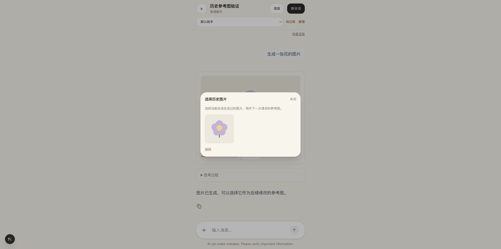

# 社区 Java SDK 与历史参考图恢复验证

日期：2026-10-23。

## 本次改动

- 对外请求、消息和事件切换为 `com.ag-ui.community` SDK；使用 Maven Central 已发布的 `java-server:0.1.1` 和 `ag-ui-spring-server-core:4.1.0`，不复制第三方源码。
- AgentScope AG-UI 依赖仅供 Harness 官方转换器使用，类型被限制在 `HarnessAguiAdapter` 内；LangChain4j 直接映射到社区 SDK 标准事件。
- Spring MVC 通过社区 `SseEventEncoder`、`OutputStreamEventSink` 和现有虚拟线程执行器输出事件；移除旧兼容编码器。
- 恢复历史卡片所属位置、分页思考与资源消息、历史参考图选择、预览与移除，并保留窄版布局及按需调试入口。

## 验证结果

- 前端 `npm test`：145 项通过；`npm run lint`、`npm run build` 通过。
- 后端 84 项回归测试通过，覆盖协议入口、Spring MVC 实际异步响应、断线解除订阅且不停止业务运行、历史卡片位置，以及原有三类 Agent、审批和停止行为。
- 社区 Java SDK 实际编码结果经过 CopilotKit Runtime 和官方 TypeScript HttpAgent 解码、归并，验证文本、工具结果、资源卡片、ISO 时间及参考图身份，无协议 schema 警告。
- 隔离端口的浏览器测试会话验证“＋ → 从历史选择 → 选择图片 → 发送”，实际请求包含 `resourceId=generated-image, role=REFERENCE, source=HISTORY`。同时验证图片卡片“用作参考”、输入框上方预览和移除。
- `git diff --check` 通过。

## 生效范围

本轮没有执行真实模型或图片生成工具，没有修改数据库结构，也没有重启用户运行中的后端。更新后端依赖并重启服务、刷新前端后生效。历史卡片排序验证包含迁移前的产品消息，不需要改写历史数据。
