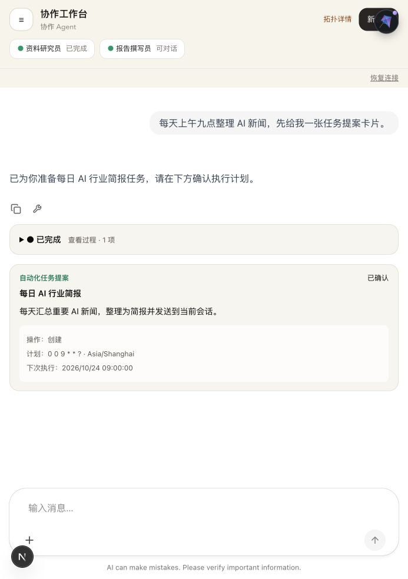

# AG-UI 改造验证记录

日期：2026-10-23。

## 自动验证

- 前端：`npm run lint`、`npm test`（139 个测试）、`npm run build` 均通过。
- 后端：JDK 26 编译及下列回归测试通过，共 82 个。
- PostgreSQL 集成测试使用实际数据库连接中的临时表并回滚，验证迁移、Mapper record 映射、用户隔离、停止代次约束、心跳过期、同会话运行互斥索引及删除级联。没有执行应用数据库迁移。
- 实际 Java SDK/兼容编码器输出经官方 TypeScript HttpAgent 解码和归并，文本、工具结果和 Activity 消息均正确，无旧扩展字段警告。
- `git diff --check` 通过。

| 测试 | 数量 | 结果 |
| --- | --- | --- |
| AguiStreamingCancellationTest | 1 | 通过 |
| AguiRunProjectionTest | 3 | 通过 |
| AguiChatRuntimeTest | 6 | 通过 |
| AguiChatControllerTest | 1 | 通过 |
| ChatServiceImplTest | 28 | 通过 |
| HarnessAgentExecutorTest | 17 | 通过 |
| HarnessSubagentLifecycleMiddlewareTest | 9 | 通过 |
| HarnessSubagentEventRelayTest | 3 | 通过 |
| AgenticSyncExecutorTest | 4 | 通过 |
| AgentStepListenerTest | 5 | 通过 |
| AgentScopeApprovalAdapterTest | 4 | 通过 |
| AguiRunSnapshotPersistenceTest | 1 | 通过 |

## 浏览器验证

使用独立的 Next.js 端口和模拟 AG-UI 后端，经过真实 CopilotKit Runtime 与 UI，验证：发送消息、工具状态、过程展开、自动化提案确认、刷新恢复确认状态、父子会话独立代理挂载及抽屉关闭。修复了 API rewrite 覆盖 Runtime 动态路由，以及页面刷新时私有代理注册竞态。

## 实际限制与部署

- 本轮没有调用真实模型或执行真实定时任务；外部模型/工具/审批引擎的端到端环境联调未执行。同步阻塞工具的停止仍依赖工具对中断的支持，停止不会撤销已经发生的外部操作。
- 代码尚未部署到运行中的应用。发布时后端执行新 Flyway 迁移，并按已更新的 Nginx 配置将 `/api/copilotkit` 指向 Next.js。
- `npm audit --omit=dev` 仍报告依赖安全告警，包括项目原有固定 Next.js 16.2.6 的 critical 告警；本次没有将框架升级到审计建议的 16.4.2。该审计不等同于上述功能测试通过。
